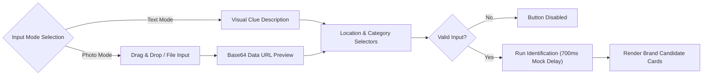

# WhatBrandIsThis Study: Vue 3 Architecture & Client-Side File Processing Guide

[](https://vuejs.org/)
[](https://vitejs.dev/)
[](LICENSE)
[](https://www.whatbrandisthis.com)
[-green.svg?style=flat-square)](#)
[](#)

---

## 🌐 Original Platform Overview: What is WhatBrandIsThis?

The original production application [**WhatBrandIsThis**](https://www.whatbrandisthis.com) is an AI-powered visual recognition engine specialized in identifying apparel brands, obscure fashion logos, vintage clothing tags, and footwear.

### The Core Problem Solved
Fashion enthusiasts, thrift shoppers, and secondhand resellers constantly encounter garments where the primary tag has faded or the logo is an enigmatic graphic:
- A stylized skeletal fossil on an outdoor jacket chest.
- An abstract geometric patch on a designer trench coat.
- An obscure stitched emblem on vintage workwear found at a flea market.

Standard reverse-image searches (such as Google Lens) frequently return generic e-commerce listings rather than specific brand origins. [whatbrandisthis.com](https://www.whatbrandisthis.com) specifically focuses on fashion morphology, textile hardware, and logo taxonomy.

### Original Features & Architecture
In the live production application at [whatbrandisthis.com](https://www.whatbrandisthis.com), the platform delivers:
1. **Logo & Embroidery Extraction**: Isolates micro-details like chest embroidery, metal zippers, button engravings, and wash labels.
2. **Text-Driven Shape Descriptors**: Allows users to identify brands by typing visual descriptions (e.g., *"two interlocking Cs with crystals"*, *"a triangular shield with a red cross"*).
3. **50,000+ Brand Database**: Encompasses global luxury fashion houses, outdoor techwear, streetwear collectives, and archival heritage brands.
4. **Authenticity & Heritage Cards**: Provides founding year, country of origin, flagship product lines, and hallmark craftsmanship markers.

---

## 🎯 Educational Edition Scope & Pedagogical Goals

This repository (`whatbrandisthis-study`) is an **isolated front-end educational shell** replicating the visual design and UX flow of the WhatBrandIsThis homepage.

> **Important Student Notice**:  
> To keep the learning curve focused on front-end browser technologies, this project replaces remote computer vision endpoints with **native HTML5 browser APIs and reactive mock datasets**. There are **no backend servers, no S3 image buckets, and zero `.env` secrets**.

### Key Learning Outcomes
- Managing the browser-native **HTML5 Drag & Drop API** inside Vue 3 templates.
- Working with `FileReader` to generate instant client-side Base64 image previews.
- Implementing dual-mode interactive forms with conditional component rendering.

---

## 📸 Architectural Visualizations

### 1. Browser-Native File Ingestion Lifecycle

```mermaid
sequenceDiagram
    autonumber
    actor User
    participant Dropzone as "Dropzone Element (.dropzone)"
    participant Input as "Hidden <input type='file'>"
    participant FileReader as "Browser FileReader API"
    participant VueState as "Vue 3 Reactive State (imagePreview)"
    participant DOM as "Virtual DOM & Image Preview"

    User->>Dropzone: Drag file over (.dropzone)
    Dropzone->>VueState: Set isDragging = true (CSS highlight)
    User->>Dropzone: Drop Image File
    Dropzone->>VueState: Set isDragging = false
    Dropzone->>FileReader: Extract File from e.dataTransfer.files[0]
    Note over FileReader: Validates MIME type: image/*
    FileReader->>FileReader: readAsDataURL(file)
    FileReader-->>VueState: Onload event: imagePreview.value = Base64 DataURL
    VueState-->>DOM: Trigger reactive re-render: display <img :src='imagePreview'>
    User->>DOM: Click 'Remove Image'
    DOM->>VueState: Clear imagePreview & reset input.value
```


### 2. Multi-Modal Identification Pipeline Flowchart


---

## 🔬 In-Depth Concept: HTML5 Drag & Drop and Client-Side File Previews

Handling native file uploads without causing accidental browser navigations or memory leaks is a classic front-end challenge.

### 1. Preventing Default Browser File Hijacking
When a user drags a file into a browser window, the default browser action is to navigate directly to the image file, leaving your web application. We counteract this in Vue 3 using **event modifiers**:

```html
<div
  class="dropzone"
  :class="{ dragging: isDragging }"
  @dragover.prevent="isDragging = true"
  @dragleave.prevent="isDragging = false"
  @drop.prevent="handleDrop"
  @click="triggerFileInput"
>
  <input
    ref="fileInputRef"
    type="file"
    accept="image/*"
    class="hidden-file-input"
    @change="handleFileChange"
  />
  <div class="drop-icon">🖼️</div>
  <p class="drop-title">Drag & drop photo here, or click to browse</p>
</div>
```

### 2. Hidden Input Pattern via Template Refs
Because native `<input type="file">` elements are notoriously difficult to style consistently across browsers, we hide the input element (`display: none`) and bind a Vue template ref `fileInputRef = ref(null)`:

```javascript
const fileInputRef = ref(null);

const triggerFileInput = () => {
  // Programmatically trigger browser native file selection dialog
  fileInputRef.value?.click();
};
```

### 3. Client-Side Base64 Encoding with `FileReader`
```javascript
const handleFile = (file) => {
  // Validate that the user provided an image file
  if (!file || !file.type.startsWith('image/')) {
    alert('Please choose a valid image file (JPG, PNG, WEBP).');
    return;
  }

  fileName.value = file.name;
  const reader = new FileReader();

  // Asynchronous callback updates reactive state once encoding completes
  reader.onload = (e) => {
    imagePreview.value = e.target.result;
  };

  reader.readAsDataURL(file);
};
```

### 4. Preventing Stale File Cache Leaks
When clearing the selected image, developers often set `imagePreview.value = null` but forget to clear the DOM input. If the user then selects the exact same file again, the `@change` event will not fire. We ensure proper reset in `clearImage()`:
```javascript
const clearImage = () => {
  imagePreview.value = null;
  fileName.value = '';
  if (fileInputRef.value) fileInputRef.value.value = ''; // Reset DOM value
};
```

---

## 📁 Source Code Directory Breakdown

```text
whatbrandisthis-study/
├── index.html                   # Entry HTML document with application mount target
├── package.json                 # Project configuration with Vue 3 and Vite dependencies
├── vite.config.js               # Development server setup (Configured for Port 3002)
├── README.md                    # Technical documentation and student exercises
└── src/
    ├── main.js                  # Application entry point mounting App.vue
    ├── App.vue                  # Main page wrapper assembling all section blocks
    ├── style.css                # Global color tokens and CSS variables
    ├── data/
    │   └── mockData.js          # Static mock brand entries, categories, and FAQs
    └── components/
        ├── Navbar.vue           # Responsive navigation bar and brand identity
        ├── HeroSection.vue      # Header banner introducing AI brand matching
        ├── BrandFinderCore.vue  # Core dual-mode upload and identification panel
        ├── FeatureList.vue      # Grid detailing logo, tag, and authenticity features
        ├── FaqSection.vue       # Interactive accordion for common questions
        └── FooterSection.vue    # Application footer with safety notes
```

---

## 🛠️ Component Implementation Details

### 1. `BrandFinderCore.vue`
- **Dual-Mode Tabs**: Seamlessly alternates between photo drag-and-drop and text description using `activeMode = ref('photo')`.
- **Form Selectors**: Binds the category filter dropdown directly to `selectedCategory = ref('all')`.
- **Simulated Analysis**: Triggers a simulated inference roundtrip of 700ms, displaying card results with confidence ratings, hallmark traits, and verification tips.

### 2. `HeroSection.vue` & `FeatureList.vue`
- Features responsive CSS Grid layouts (`grid-template-columns: repeat(auto-fit, minmax(280px, 1fr))`) ensuring mobile readability.

---

## 🚀 Getting Started

### Prerequisites
- **Node.js**: `v18.0.0` or higher (Tested on `v23.11.0`)
- **Package Manager**: `npm` (v10+), `pnpm`, or `yarn`

### Installation & Local Development
```bash
# 1. Navigate to the project directory
cd whatbrandisthis-study

# 2. Install dependencies
npm install

# 3. Start the Vite development server
npm run dev
```

Visit the local development server:
```
http://localhost:3002
```

### Production Build
```bash
# Verify the build pipeline
npm run build

# Preview production build locally
npm run preview
```

---

## 🎓 Recommended Exercises for Students

1. **Exercise 1: File Size Guard**:  
   Add an upper-bound file size check (5MB) in `handleFile()` and display an inline warning toast.
2. **Exercise 2: Alternative Object URL Implementation**:  
   Refactor `handleFile()` to use `URL.createObjectURL(file)` and manage memory revocation via `URL.revokeObjectURL()`.
3. **Exercise 3: Dynamic Category Filter**:  
   Filter the mock brand candidates displayed in the results card based on `selectedCategory.value`.
